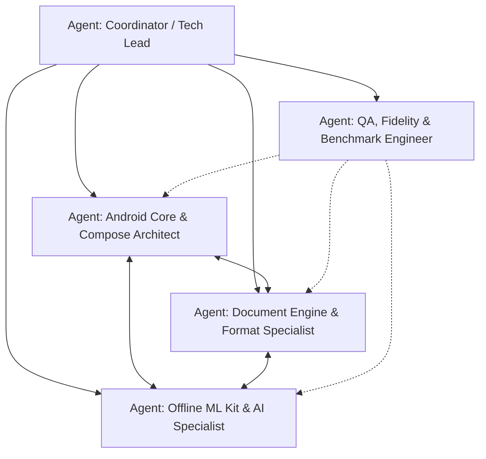

# Autonomous Agents Specification: LibreMobile (Android ML Office)

This document defines the specialized agent roles, system boundaries, workflows, and responsibilities for developing the **LibreMobile** Android office productivity suite featuring offline Google ML Kit capabilities.

---

## 1. Agent Architecture & Roster

### 1.1 Agent: Coordinator / Tech Lead
- **Role**: Oversees architecture consistency, milestones, module decoupling, and code reviews.
- **Responsibilities**:
  - Enforce module boundaries (Clean Architecture / MVI).
  - Manage dependency versioning, Gradle conventions, and ProGuard / R8 rules.
  - Review cross-module contracts and data transfer objects.

### 1.2 Agent: Android Core & Compose Architect
- **Role**: Native Android UX/UI, navigation, performance, and hardware integration.
- **Responsibilities**:
  - Design UI with **Jetpack Compose** following Material 3 guidelines.
  - Implement canvas-optimized rendering for text, spreadsheets, and presentation slides.
  - Manage app lifecycle, foreground/background coroutine scopes, and memory caches (Bitmap & DOM tree).
  - Implement Document Provider / Storage Access Framework (SAF) integration.

### 1.3 Agent: Document Engine & Format Specialist
- **Role**: Document parsing, editing DOM representation, serialization, and file I/O.
- **Responsibilities**:
  - Integrate and optimize open-source document libraries (Android-compatible Apache POI fork, lightweight XML/ZIP parsers).
  - Design unified in-memory document model (AST / Document Node Tree) shared across:
    - **Writer**: DOCX, ODT, TXT, PDF export.
    - **Calc**: XLSX, ODS, CSV (with formula engine).
    - **Impress**: PPTX, ODP (shape, text frame, and layout rendering).
  - Implement incremental saving, Undo/Redo stack, and conflict-free transactional edits.

### 1.4 Agent: Offline ML Kit & AI Specialist
- **Role**: On-device machine intelligence, document digitization, and offline NLP.
- **Responsibilities**:
  - Integrate **Google ML Kit Document Scanner API** (high-res capture, perspective rectification, shadow removal).
  - Integrate **ML Kit Text Recognition v2** (Latin, CJK, Devanagari offline models).
  - Integrate **Entity Extraction** (dates, URLs, phone numbers, addresses, tracking codes) with direct document-linking actions.
  - Integrate **Language Identification & On-Device Translation** (dynamic model download and local caching).
  - Implement on-device smart document features (smart action suggestions, tabular data extraction from OCR bounding boxes into Calc sheets).

### 1.5 Agent: QA, Fidelity & Benchmark Engineer
- **Role**: Test automation, format fidelity verification, performance profiling, and memory leak detection.
- **Responsibilities**:
  - Create round-trip fidelity test suites (open file -> render -> edit -> save -> verify with LibreOffice desktop CLI).
  - Benchmark APK size, cold start time, memory consumption on low-end devices (2GB-4GB RAM).
  - Write Compose UI tests and end-to-end integration tests using Mock Document sources.

---

## 2. Agent Collaboration Protocol

1. **Requirement Handoff**: Feature requests flow from Coordinator -> Core/Engine/ML -> QA Engineer.
2. **Contract-First Development**:
   - Engine and ML agents provide pure Kotlin interfaces independent of Android UI.
   - Core Architect implements Compose screens strictly against ViewModel state flows.
3. **Verification Gate**:
   - Any modification to file parsers requires passing the round-trip fidelity test suite before merge.
   - ML Kit models must run in background threads (`Dispatchers.Default` / `Dispatchers.IO`) without frame drops (<16ms frame budget).

---

## 3. Technology Stack Matrix

| Layer | Component | Selection |
|---|---|---|
| **Language** | Kotlin | 2.0+ (K2 compiler, Coroutines, Flow) |
| **UI Framework** | Jetpack Compose | Material 3, Compose Foundation (Canvas / Layout) |
| **Architecture** | MVI / Clean Architecture | ViewModel, StateFlow, Coroutines |
| **Doc Parsers** | Apache POI Android / Custom | POI Android port, docx4j-light, fast XML streaming (XmlPullParser) |
| **ML Engine** | Google ML Kit (Offline) | Document Scanner, Text Recognition v2, Entity Extraction, Translation |
| **Storage & I/O** | Android SAF & Room | Storage Access Framework, Room DB for recent files & metadata |
| **Testing** | JUnit 5 & Robolectric | Truth, MockK, Compose Testing, Macrobenchmark |
