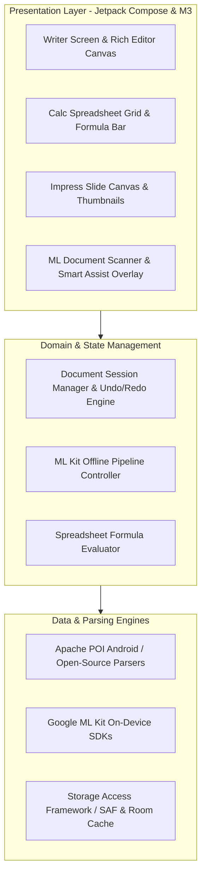

# Project Implementation Plan: LibreMobile (Android ML Office Suite)

A comprehensive, phased engineering roadmap for building a native Android LibreOffice-style productivity suite (Writer, Calc, Impress) powered by Google ML Kit for 100% on-device document intelligence.

---

## 1. System Architecture Overview

---

## 2. Project Phases & Milestones

### Phase 1: Foundation & Project Scaffolding
- [x] **1.1 Multi-Module Gradle Setup**
  - `:app`: Application entry point, dependency injection (Hilt/Koin), navigation.
  - `:core:ui`: Material 3 design system, themes, reusable canvas components.
  - `:core:model`: Unified Document DOM, Node hierarchy, formatting styles.
  - `:feature:writer`: Word processor document editor (DOCX, ODT, TXT).
  - `:feature:calc`: Spreadsheet editor & formula engine (XLSX, ODS, CSV).
  - `:feature:impress`: Presentation viewer & slide editor (PPTX, ODP).
  - `:core:engine`: Open-source parsers, serialization, and streaming I/O.
  - `:core:ml`: ML Kit integration layer (Scanner, OCR, Entity Extractor, Translator).
- [x] **1.2 Storage Access Framework (SAF) & File Manager**
  - Android SAF picker, scoped storage management, recent files, and metadata caching (Room DB).
- [x] **1.3 Memory & Performance Budgeting**
  - Set baseline thresholds for memory footprints (<150MB active session) and APK size optimization via ProGuard/R8.

---

### Phase 2: Document Engine & Parser Integration
- [x] **2.1 Document Engine Core Setup**
  - Integrate Android-compatible Apache POI fork (`poi-android` / POI 5.x adapted for Android bytecode).
  - Establish fast XML streaming readers (`XmlPullParser`) for quick preview rendering.
- [x] **2.2 Writer Module (DOCX, ODT, TXT, PDF)**
  - Parse paragraph styles, character runs, bullet lists, tables, and inline images.
  - Implement bidirectional DOM-to-file serialization.
  - Compose-based virtualized document renderer with touch selection, caret positioning, and soft keyboard input.
- [x] **2.3 Calc Module (XLSX, ODS, CSV)**
  - High-performance infinite 2D grid rendering using Compose Canvas.
  - Virtualized row/column layout with cell selection and drag-fill support.
  - In-memory spreadsheet model with formula evaluator (SUM, AVERAGE, IF, VLOOKUP, math functions).
- [x] **2.4 Impress Module (PPTX, ODP)**
  - Slide thumbnail strip + active slide viewport.
  - Shape, text box, and image rendering.
  - Basic slide manipulation (reorder, add slide, edit text elements).

---

### Phase 3: Offline ML Kit Integration
- [x] **3.1 Google Document Scanner API**
  - Native document capture sheet with auto-edge detection, perspective rectification, and shadow removal.
  - Multi-page scanning directly into a new Writer document or PDF export.
- [x] **3.2 ML Kit Text Recognition v2 (OCR)**
  - Offline Latin, CJK, and Devanagari model packs.
  - Bounding box analysis:
    - Flow recognized text into Writer with preserved paragraph layout.
    - Table detection: Convert aligned text blocks into structured Calc sheet cells.
- [x] **3.3 Entity Extraction**
  - Offline extraction of dates, phone numbers, addresses, emails, and tracking numbers.
  - Interactive chip overlays: tap date -> Add to Calendar; tap phone -> Dial; tap address -> Open Map.
- [x] **3.4 On-Device Translation & Language Identification**
  - Automatic language detection for active document runs.
  - On-demand offline translation model downloads and instant inline translation.
- [x] **3.5 Offline Smart Actions**
  - Document summarization heuristics and context-sensitive quick action suggestions.

---

### Phase 4: Polish, Export, & Round-Trip Testing
- [x] **4.1 Export & Sharing Pipeline**
  - PDF generation for Writer, Calc, and Impress documents via Android `PdfDocument` / POI.
  - Clean export back to `.docx`, `.odt`, `.xlsx`, `.ods`, `.pptx`, `.odp`.
- [x] **4.2 Round-Trip Fidelity & Stress Testing**
  - Automated tests comparing source files and edited exports against standard LibreOffice test corpus.
  - Stress testing with 50+ page DOCX files and 10,000+ row XLSX files.
- [x] **4.3 UI/UX Polish**
  - Full Dark Mode support across document viewports.
  - Stylus and physical keyboard shortcut support (Ctrl+B, Ctrl+Z, arrow navigation, S-Pen gestures).

---

## 3. Risk Mitigation & Technical Strategies

| Risk | Impact | Strategy |
|---|---|---|
| **Apache POI DEX / Method Limits & Speed** | High memory usage, slow load times on mobile. | Strip unused POI components (e.g. legacy binary formats if needed); use streaming reader for preview; run heavy operations in background worker (`Dispatchers.IO`). |
| **Large Spreadsheet Rendering Performance** | Frame drops during fast scrolling. | Custom Jetpack Compose `Canvas` with cell viewport culling (only render visible cells on screen). |
| **ML Model Download Storage Footprint** | App bloat or storage errors. | Bundle core OCR; download language translation models on-demand with local storage management. |
| **Document Formatting Fidelity** | Visual divergence between desktop LibreOffice and mobile app. | Adopt strict CSS/RTF-like intermediate representation and regression test with desktop LibreOffice headless conversions. |
