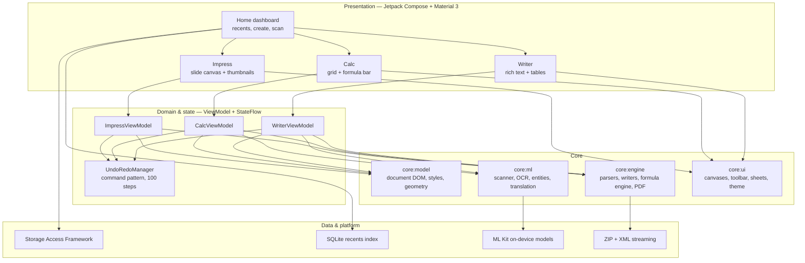

# LibreMobile

**An offline-first Android office suite — Writer, Calc and Impress with on-device document intelligence powered by Google ML Kit.**

LibreMobile is a native Android productivity suite for editing word-processing, spreadsheet and presentation documents on a phone or tablet, without sending a single byte of document content to a server. It reads and writes the formats people actually exchange — DOCX, ODT, XLSX, ODS, PPTX, ODP, CSV and TXT — and layers OCR, entity extraction, language identification and translation on top, entirely on-device.

> **Status:** functional pre-1.0. All three editors load, edit and export documents; ML features run on-device. Fidelity against desktop LibreOffice is improving (see [Roadmap](#roadmap)).

---

## Highlights

- **Three editors, one document model.** A shared, immutable Kotlin document tree (`core:model`) is rendered by three Compose feature modules — no per-format UI duplication.
- **100% offline AI.** OCR (Latin / Chinese / Devanagari), entity extraction, language identification and translation run through ML Kit's on-device APIs. No network round-trips, no API keys.
- **Document scanner.** ML Kit Document Scanner captures multi-page scans with edge detection, perspective correction and shadow removal, then exports to JPEG pages or a single PDF.
- **Smart document actions.** Recognised phone numbers, emails, addresses, URLs, dates and tracking numbers become tappable actions — dial, email, open in Maps, add to Calendar, browse.
- **Real spreadsheet engine.** A hand-written recursive-descent formula parser and evaluator with cell ranges, cross-sheet references, cycle detection and 20+ functions.
- **Storage Access Framework native.** Open and save into any provider (Drive, Downloads, SD card) with persistable URI permissions and a local recents index.
- **Modern Android stack.** Kotlin 2.0, Jetpack Compose + Material 3, Navigation Compose, coroutines/Flow, MVI-style unidirectional state, `minSdk 26`.

---

## Table of contents

- [Highlights](#highlights)
- [Architecture](#architecture)
- [Tech stack](#tech-stack)
- [Supported formats](#supported-formats)
- [Feature tour](#feature-tour)
- [Formula engine](#formula-engine)
- [Getting started](#getting-started)
- [Building and testing](#building-and-testing)
- [Project layout](#project-layout)
- [Roadmap](#roadmap)
- [Contributing](#contributing)
- [License](#license)

---

## Architecture

LibreMobile follows a layered, multi-module architecture. Modules depend inward only: features know about `core`, and `core` knows nothing about Android UI.



### Module responsibilities

| Module | Type | Responsibility |
| --- | --- | --- |
| `:app` | Android app | Entry point, navigation graph, recents repository, SAF plumbing, intent handling |
| `:core:model` | Kotlin JVM | Framework-free document model for Writer, Calc and Impress; geometry and colour primitives; generic undo/redo |
| `:core:engine` | Kotlin JVM | ZIP/XML readers and writers for every supported format, formula evaluator, PDF export |
| `:core:ml` | Android library | ML Kit wrappers: document scanner, OCR, entity extraction, language ID, translation, smart assistant |
| `:core:ui` | Android library | Compose canvases (text, grid, slides), editor toolbar, formula bar, smart action sheet, theme |
| `:feature:writer` | Android library | Writer screen + ViewModel |
| `:feature:calc` | Android library | Calc screen + ViewModel |
| `:feature:impress` | Android library | Impress screen + ViewModel |

### Design principles

- **Immutable models.** Every document is an immutable value tree. Edits produce a new instance, which makes undo/redo a list of pure `Command<T>` objects (`execute` / `undo`) and makes Compose recomposition predictable.
- **Unidirectional data flow.** Each editor exposes a single `StateFlow<XxxUiState>`; the UI emits intents, the ViewModel mutates state. No shared mutable state between layers.
- **Android-free core.** `core:model` and `core:engine` are plain Kotlin JVM modules, so parsing, formulas and serialization are unit-testable on the desktop JVM without an emulator.
- **Streaming I/O.** Engines work against `InputStream` / `OutputStream` supplied by the SAF, so documents never need to be copied into app-private storage.

---

## Tech stack

| Layer | Choice |
| --- | --- |
| Language | Kotlin 2.0.20 (JVM target 21) |
| Build | Gradle 8.9, Kotlin DSL, version catalog (`gradle/libs.versions.toml`) |
| UI | Jetpack Compose (BOM 2024.09.00), Material 3, Material Icons Extended |
| Navigation | Navigation Compose 2.8.0 |
| State | ViewModel + `StateFlow` + coroutines 1.8.1 |
| Min / target / compile SDK | 26 / 34 / 34 |
| ML | ML Kit Document Scanner, Text Recognition v2, Entity Extraction, Language ID, Translation |
| Storage | Storage Access Framework, `SQLiteOpenHelper` recents index |
| Tests | JUnit 5, Truth, `kotlinx-coroutines-test` |

---

## Supported formats

| Editor | Read | Write |
| --- | --- | --- |
| Writer | DOCX, ODT, TXT | DOCX, ODT, TXT, PDF |
| Calc | XLSX, ODS, CSV | XLSX, ODS, CSV, PDF |
| Impress | PPTX, ODP | PPTX, ODP, PDF |

`DocumentType` (`core:model/common/DocumentType.kt`) is the single source of truth for extensions, display names and MIME types; the activity manifest registers an intent filter for every MIME type, so LibreMobile appears in the system "Open with" sheet for these documents.

---

## Feature tour

### Writer
Paragraphs, character runs, headings H1–H6, bullet and numbered lists, tables with spans, and page setup (size, orientation, margins). Formatting toolbar for bold/italic/underline, alignment, heading level and lists, plus undo/redo and dirty-state tracking.

### Calc
Canvas-rendered grid with viewport culling, tap-to-select cells, touch panning, per-column width and per-row height metadata, a formula bar with coordinate readout, and automatic formula evaluation on load and on edit.

### Impress
Slide viewport with a scrollable thumbnail strip, rectangle/ellipse/text-box shapes with fill and stroke, bullet text frames, add/delete/select slides, and per-slide background colour.

### Offline ML layer
| Capability | API | Notes |
| --- | --- | --- |
| Document scanning | ML Kit Document Scanner | Up to 100 pages, gallery import, JPEG + PDF results, Google Play Services check with graceful degradation |
| OCR | Text Recognition v2 | Latin, Chinese and Devanagari recognisers, word/line/block bounding boxes |
| Entity extraction | Entity Extraction | Phone, email, address, date/time, URL, tracking number, money |
| Language ID | Language Identification | BCP-47 code per document, `"und"` when undetermined |
| Translation | On-Device Translation | Model downloaded on demand, source auto-detected |
| Smart actions | `SmartDocAssistant` | Combines the above into dial/email/map/calendar/browse actions, reading time and extractive key points |

OCR output can be pushed into Writer as paragraphs (layout preserved from bounding boxes) or into Calc as a structured sheet — see `TextRecognitionEngine` and `CalcViewModel`.

### Storage and recents
`StorageAccessManager` takes persistable read/write grants on picked URIs, resolves display names and sizes via `OpenableColumns`, and exposes stream helpers. A SQLite table (`libremobile_recent.db`) keeps the last 50 documents and drives the home dashboard.

---

## Formula engine

`FormulaEngine` is a hand-written tokenizer plus recursive-descent parser, so no third-party expression library is bundled.

- **Types:** `NumberVal`, `StringVal`, `BooleanVal`, `ErrorVal`, `RangeVal`
- **Operators:** `+ - * / ^`, string concatenation `&`, comparisons `= <> < > <= >=`
- **References:** A1 notation, absolute markers (`$A$1`), and ranges (`A1:C3`)
- **Cycle protection:** an in-progress evaluation set reports circular references instead of recursing
- **Semantics:** Excel-style coercion (numbers from strings, booleans as 1/0), errors propagated through ranges

**Functions:** `SUM`, `AVERAGE`, `COUNT`, `COUNTA`, `MIN`, `MAX`, `ROUND`, `ABS`, `SQRT`, `IF`, `AND`, `OR`, `NOT`, `VLOOKUP`, `LEN`, `LEFT`, `RIGHT`, `TRIM`, `UPPER`, `LOWER`, `CONCATENATE`.

---

## Getting started

### Prerequisites

| Tool | Version |
| --- | --- |
| JDK | 21 |
| Android SDK | Platform 34, Build-Tools 34.x |
| Gradle | 8.9 (wrapper included) |
| Device / emulator | Android 8.0+ (API 26) |
| Google Play Services | Required for ML Kit scanner, OCR and translation |

### Setup

```bash
git clone https://github.com/faridhafizh/mobile-office.git
cd mobile-office
```

Create `local.properties` pointing at your SDK (this file is git-ignored):

```properties
sdk.dir=/path/to/Android/Sdk
```

### Build

```bash
./gradlew assembleDebug          # debug APK -> app/build/outputs/apk/debug/
./gradlew assembleRelease        # minified + resource-shrunk release APK
./gradlew installDebug           # build and install on a connected device
```

### Test

```bash
./gradlew test                   # all JVM unit tests (core:model, core:engine, core:ml)
./gradlew :core:engine:test      # parser, writer, formula and PDF tests
./gradlew connectedAndroidTest   # instrumented tests (device/emulator required)
```

The `core:model` and `core:engine` suites run entirely on the JVM — no emulator needed for round-trip document and formula tests.

---

## Project layout

```
mobile-office/
├── app/                     # Application, navigation, recents, SAF, home dashboard
├── core/
│   ├── model/               # Immutable document DOM, styles, geometry, undo/redo
│   ├── engine/              # DOCX/ODT/TXT, XLSX/ODS/CSV, PPTX/ODP, formula, PDF
│   ├── ml/                  # ML Kit: scanner, OCR, entities, language ID, translation
│   └── ui/                  # Compose canvases, toolbar, formula bar, theme
├── feature/
│   ├── writer/              # Writer screen + ViewModel
│   ├── calc/                # Calc screen + ViewModel
│   └── impress/             # Impress screen + ViewModel
├── gradle/libs.versions.toml
└── LICENSE
```

---

## Roadmap

Current emphasis:

- Improve round-trip fidelity against a LibreOffice test corpus (styles, numbering, table borders, drawing anchors).
- Rich text editing surface: selection handles, caret placement and IME composition inside the canvas.
- Chart rendering and chart embedding for Calc.
- Image support in Writer/Impress output.
- Richer PDF export (embedded fonts, vector shapes, page-level layout).
- Compose UI tests and Macrobenchmark profiles for APK size, cold start and scroll jank.

Known limitations: PDF export lays out text only; Impress export preserves shapes and text but not animations or transitions; Calc supports one active sheet's visible range at a time in PDF export.

---

## Contributing

1. Fork the repository and create a feature branch.
2. Keep module boundaries: pure Kotlin in `core:model` / `core:engine`, Android dependencies in `core:ml`, `core:ui` and `feature:*`.
3. Add or update unit tests for parser and model changes; run `./gradlew test` before pushing.
4. Open a pull request describing the change and the formats affected.

---

## License

Released under the [MIT License](LICENSE) © 2026 Muhammad Farid Hafizh.